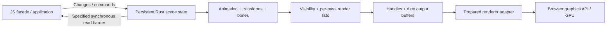

# Architecture

The runtime offers bounded compatibility and explicit ownership paths. C3 adds a
prepared ordinary-Mesh main pass; a complete compatible CPU engine remains planned.

| Path | State authority and work | Contract |
|---|---|---|
| Compatible transform bridge | Public JS objects own mutable values; a Rust arena computes eligible transform batches | [Compatibility](COMPATIBILITY.md) |
| Persistent transform facade | JS owns public inputs/topology; Rust retains evaluated matrices; tracked writes and demand-driven snapshots | [C2 contract](PERSISTENT_FACADE.md) |
| Prepared main-pass facade | Retained transform topology and derived state; native visibility/order/draw matrices consumed by the pinned WebGL renderer | [C3 contract](PREPARED_PASS.md) |
| Explicit owned animation | Rust owns finite clips/actions, poses, hierarchy, world transforms and palettes; JS consumes final presentation data | [Owned API](OWNED_ANIMATION.md) |
| Wider compatible CPU engine | Broader animation/pass/resource contracts remain planned beyond C3 | [Direction](RUST_ENGINE_STRATEGY.md) |

## Transform bridge

Public objects remain the r186 JavaScript implementation. They are the public
mutation surface. Each eligible `updateMatrixWorld` call collects the subtree in
parent-first order, synchronizes observed values into a persistent Rust arena,
executes one Wasm batch, and writes local/world results back into the same public
arrays. The method returns instead of running upstream JS compose/multiply.
The existing renderer consumes those results without a second scene transform
pass. Its view/model/normal matrix work, culling, sort, skeleton update, GPU
submission and shaders are not ported or removed.

The build verifies the exact upstream Object3D SHA-256 before applying guarded
source hooks (constructor and three update methods; facade hooks are inactive in
legacy modes). It bundles that source as one core and rewrites addon core imports
to the same package root. There are no global prototype patches in the package.
Instrumentation wrappers exist only in M0 profiling. The runtime does not import
Three or call its JS math from Rust. Wasm instantiation has no JS math imports.

Arena layout is 64 f64 slots per node: 0–9 TRS, 10–13 pivot/presence,
14 parent index, 15 auto/world-auto/needs flags, 16–31 local matrix,
32–47 world matrix, 48 propagated force, 49 has-parent. Slot zero stores the
external parent world matrix and incoming force. Parent indices precede children;
the Rust kernel validates topology before computing. Rust owns Vec storage and
retains state across frames. JS compares before stores but still scans each
field. It writes 32 result elements per node each call, preserves Array identity,
and recreates a typed view if Wasm memory grew. This is not zero-copy public API.

Contexts are weakly keyed by subtree root; ephemeral traversal arrays currently
allocate on every batch. A root with custom update methods cannot batch as one
unit; original JS traversal invokes descendants, which may individually batch.
Camera and SkinnedMesh override/post-processing therefore execute in original
order. `updateWorldMatrix` and synchronous read helpers remain JS; those results
are observed by the next batch. No hidden stale-state cache assumes the frame
boundary is the only update boundary.

`release(root)` frees arenas currently associated with that root and descendants.
If an arena-owning subtree was removed earlier, release it separately or allow
best-effort GC cleanup. Rust handle IDs are never recycled; released IDs fail
rather than alias new objects. Tombstone metadata and the Wasm high-water memory
remain. This is a research alpha, not an optimized lifetime manager.

Three controlled implementations share the source/package: B returns to original
JS immediately; C executes Rust; D executes the same packed calculation in JS.
A remains the official upstream module build. D measures this particular batched
JS implementation, not the best achievable JS engine. Every mode retains the
same public APIs and assets in the tested fixture set.

## Prepared main pass (C3)

The optional facade retains numeric parent/slot/generation topology, dirty input
records and evaluated f64 matrices. Native transform and pass calls surround the
required camera/scene callback boundary; intermediate worlds remain in the arena.
Rust computes inherited visibility, sphere culling, default ordering and per-draw
matrices. JS consumes compact resource/draw lists and final matrices through
hash-guarded renderer hooks. Replaced JS projection/sort/matrix work is skipped.

Public inputs/hierarchy, resource updates, materials/shaders, GPU calls and shadow
rendering remain JS. Unsupported passes use explicit upstream fallback. This is
not sole public scene ownership or a full renderer port. See the [contract and
limits](PREPARED_PASS.md) and [complete-path verdict](PREPARED_REPORT.md).

## Intended complete ownership boundary

This is the long-term hypothesis. C3 demonstrates a bounded prepared-main-pass
consumer and equivalent JS comparison; it does not connect ordinary animation,
skinning and every pass into this complete pipeline. Ordinary upstream
renderer.render(scene,camera) is not a generic prepared-list input. See
PROJECT_PLAN.md and ADR 0002 for the broader gates.
