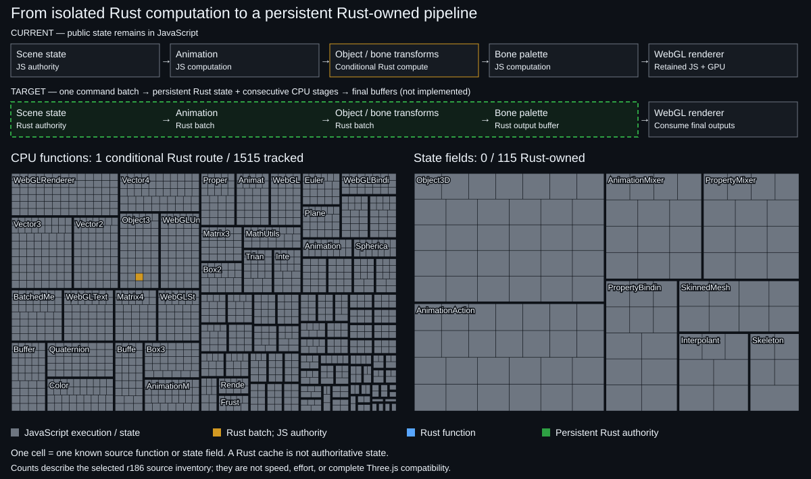

# Product readiness and implementation progress

[Adoption goals](PRODUCT_GOALS.md) define when an application has a reason to migrate.
README and the standalone page lead with a separate gate overview from
product-goals.json. Early evidence does not mean qualification; there is no overall
completion percentage. The existing fine-grained map below remains implementation
evidence, and its historical counts retain their original meaning.



[Progress history](https://postmelee.github.io/three.rust/history.html) · [Raw inventory](progress.json) ·
[Standalone page](progress.html) · [Source selection](progress-source.json)

The upper bands distinguish the compatibility facade from the implemented, bounded
explicit owned-rig API. The facade arena remains a cache of authoritative JS values.
The opt-in domain owns its animation/pose/world/palette state. Broader scene-core
ownership is still planned. Computation and state ownership are independent.

## Units and legend

| Color | Meaning |
|---|---|
| Gray | JavaScript execution or JavaScript-owned state |
| Amber | Scoped Rust computation; inspect the declared API tier and exclusions |
| Blue | A callable's computation is implemented in Rust within its declared contract |
| Green | The logical field is authoritative in Rust within the explicit owned API |

The left map has one tile per named callable definition in the selected Three.js
source files. The right map has one tile per statically declared state field in
selected scene/animation classes. These are different denominators, not equal
work estimates. Neither map is a percentage of all Three.js or proof of speedup.
Some public metadata, controls and callbacks may intentionally remain in JS.
Tiles identify upstream semantics, not a required one-to-one Rust class or function
layout. A Rust batch can combine many operations; a claim is added only for its
verified scope. A green field means Rust owns the corresponding logical state,
not that Rust happens to allocate another copy with the same name.

Three source mappings are amber: the existing eligible Object3D transform route,
plus bounded AnimationMixer.update and Skeleton.update algorithms in the explicit
owned API. The latter ordinary JS methods still run in JS. Twelve green fields
map logical rig TRS/parent/world, action time/scale/weight/pause/loop and inverse-bind/
palette state to Rust authority in that opt-in domain. Ordinary Three.js objects do
not acquire Rust authority. Each mapping links the finite contract and tests.

This extends the original conditional-computation legend to distinguish API tiers;
it does not count helper arithmetic as globally ported public math methods. Scalar
Matrix4/Quaternion APIs remain JS. Renderer/shader work is not counted as removed.
Full event/binding/facade semantics are outside the new mappings. See
[owned API](OWNED_ANIMATION.md) and its [experimental ADR](adr/0003-owned-animation-experiment.md).

## Source extraction

`scripts/progress-source.mjs` parses three@0.186.1 with the locked TypeScript
parser. It inventories named function declarations, class methods/accessors,
variable-assigned functions and `this.method = function` definitions under
animation, cameras, core, math, objects, renderers/webgl and WebGLRenderer.js.
Constructors, anonymous callbacks, inherited duplicates, imported code and addon
sources are excluded. Nested named helpers count independently; source identity
includes path, qualified name, kind where needed and duplicate ordinal.

State extraction covers Object3D, AnimationAction, AnimationMixer, PropertyBinding,
PropertyMixer, Interpolant, Skeleton and SkinnedMesh. It collects unique literal
`this.field = ...`, Object.defineProperty and Object.defineProperties declarations
in those classes, including initialization helpers. It does not infer dynamic
computed property names, inherited fields or arbitrary runtime object structure.
Ordinary nested functions have their own this and are excluded from field collection.

Each item records a pinned upstream path and source line. Every scanned file has
a SHA-256 in progress-source.json. CI regenerates from the clean pinned dependency
and fails on drift. Explicit reviewed overrides in progress-inventory.json add
Rust execution/ownership claims and evidence links; absence means JS. AST parsing
establishes declarations, not correctness or semantic completeness.

## Generation and history

```sh
npm ci
npm run docs:generate
npm run docs:check
npm run test:progress
```

The npm generator first refreshes the source extraction, then runs
`python3 tools/progress.py` (Python 3.10+, standard library only). After an actual
reviewed observation, record the **implementation commit being observed**:

```sh
python3 tools/progress.py --record FULL_IMPLEMENTATION_COMMIT_SHA
```

Ordinary generation never fabricates a new observation or alters history.
The original 6/29 capability and 7/12 evidence counts are retained as schema 2.
The source-derived schema 3 observation uses the same unchanged engine, with a
new denominator. History does not join these into a misleading progress curve.
The chart has separate computation and state panels. Solid series show Rust
computation, conditional batch routes and authoritative state; dashed series show
their declared totals. Hover, tap or focus a date for exact counts. One comparable
date produces points, not a fabricated trend; different upstream pins are not joined.

The [public history](https://postmelee.github.io/three.rust/history.html) uses the
last first-parent main commit per UTC day. `tools/status_site.py` reads each day's
**committed schema-3 inventory**, not a retrospective inference from today's rules.
Days without that inventory are omitted. Legacy observations remain separately
available. `history.json` retains full commit IDs, counts, source and upstream pins.
Changes to extraction rules/denominators must be interpreted through those records;
counts alone do not establish implementation or performance gains.

The checked-in `docs/progress-history.json` is an explicit observation ledger.
`npm run docs:generate` renders that ledger for local review. The Pages build
assembles daily main history without rewriting it or fabricating observations.
Open `/docs/progress.html` or `/docs/history.html` with `npm run dev`; these local
previews also ship in the portable demo. HISTORY.md is a readable repository
fallback. Pages use inline SVG and a small inline interaction script, with no
external runtime dependencies. `sourceRef` targets main.

Build a fresh public-site preview and validate its project subpath:

```sh
npm run bundle:status
npm run test:status
# For another build, use a new output directory:
python3 tools/status_site.py work/status-site-next
node tests/status-site.mjs work/status-site-next
```

Public deployment and first-time activation are documented in [CI](CI.md#public-status-site).

Presentation reference: [AnyPS5](https://boykopovar.github.io/AnyPS5/progress.html).
Its function/instruction units inspired the fine-grained report; no AnyPS5 code
or artwork is copied. This project's generator and source extraction are independent.
