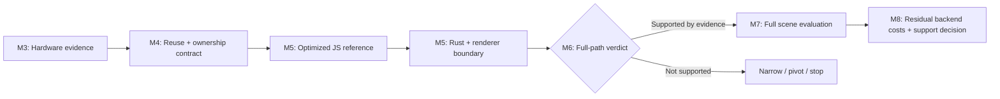

# three.rust — ownership-driven project plan

The goal is a **Rust-owned scene evaluation engine**, exposed through a bounded
Three.js-style JavaScript interface and compiled to Wasm. It should keep useful
state and consecutive CPU computations inside Rust, then deliver compact results
to the renderer. One-to-one source translation and ported line counts are not
success criteria. The local package is `rthree`; complete compatibility and
whole-frame acceleration remain unproven.

## Product destination and release gates

The destination is a useful replacement for declared real Three.js applications:
small migration, equivalent behavior and worthwhile end-to-end performance.
The prospective [adoption contract](PRODUCT_GOALS.md) and [ADR 0004](adr/0004-adoption-goals.md)
define six gates. Initial application targets are at least 20% and 1 ms CPU p50/p95
saving versus Three.js, with a separate matched-JS gate before recommending Rust.
These are future qualification budgets, not current results or a universal promise.
An explicit accelerator can be released first; import/init/config-only application
replacement requires the stronger migration contract and a new qualification.
README Status tracks these gates; source ownership remains a separate engineering view.

## Requirements, hypothesis and measured facts

**Requirements:** real browser rendering, explicit Wasm initialization, documented
synchronous semantics and identity, usable addon/package/type resolution, exact
scope claims and reproducible comparisons. Preserve unfavorable workloads and
an optimized equivalent JS control. No automatic npm publication.

**Hypothesis:** persistent scene state → animation evaluation → object/bone
transforms → visibility/LOD → per-pass lists/sorting → upload preparation can
amortize the JS/Wasm boundary. JS may retain small public values, UI and controls;
its public class layout need not match Rust storage. A large boundary is useful
only if it contains enough work and avoids intermediate round trips.

**M2 observation:** JS public properties remain authoritative. Each batch scans
those objects into a persistent Rust arena, computes transforms and writes public
matrices back. Persistence alone does not establish Rust state authority. This
narrow experiment does not test the full ownership hypothesis.

For the enlarged hierarchy, original/Wasm main CPU p50 was 16.5/20.8 ms (medians
of per-run quantiles). Separate diagnostic means were 3.566 ms synchronization,
1.154 ms Rust call and 1.192 ms materialization. Do not subtract these means from
main-run quantiles. All measurements used shared CPU/SwiftShader; next-target
ranking must be rechecked on hardware. See [REPORT](REPORT.md).

## Historical milestones

| Milestone | Completed bounded research scope | Limit |
|---|---|---|
| M0 | Fresh pinned public examples, profiles and target ADR committed before port | Cloud evidence, not hardware target ranking |
| M1 | Local ESM package, A/B/C/D resolution, explicit init, addon identity, types and demo | Tested subset only; no npm publication |
| M2 | Rust f64 transform arena, renderer integration, JS bypass proof, correctness and 140 runs | No general whole-frame gain; no broad state ownership |

M0–M2 are completed experiments, not a completed engine or acceleration claim.
Their historical work predates Hyper-Waterfall and is not relabeled as following it.

## Future milestones and exit gates

| Milestone | Deliverable | Exit gate |
|---|---|---|
| M3 — Evidence and project infrastructure | Governance, CI/artifacts, qualified GPU runner, A/A and A/B/C/D baselines, workload profiles | Actual hardware evidence and a full-pipeline cost model; YAML alone is insufficient |
| M4 — Rust ownership and compatibility contract | Reuse/renderer assessment, selected pipeline, state/read/write contract and cost budget | Source/license/build validation; measured useful CPU slice; contract and thresholds recorded before porting |
| M5 — Integrated persistent CPU pipeline | Equivalent optimized JS reference, Rust implementation and renderer consumption | Correct outputs/events; actual Rust execution; replaced JS work and intermediate duplication absent |
| M6 — Product performance and release decision | First-pipeline hardware/browser evaluation, lifecycle/compatibility audit, bounded verdict | Predeclared full-path improvement/regression criteria assessed; continue, narrow, pivot or stop |
| M7 — Complete scene evaluation core | Conditional expansion through visibility, LOD, multi-pass lists and dirty upload buffers | Renderer consumes prepared outputs without repeated scene evaluation; full semantic/performance evidence |
| M8 — Backend scope and sustainable release decision | Residual-cost assessment, adapter/reuse decision and support strategy | Expand resource/shader/backend work only if justified; documented release scope or stop decision |

M6's verdict covers the first pipeline, not the entire engine. M7/M8 are gated
future work. Exact GitHub issues and dependencies live in [roadmap.json](roadmap.json).
Milestone association is synchronized by Actions; open work is not marked complete
merely because code, a diagram or an issue exists.

## Two API tracks

1. **Compatibility facade:** ordinary JS objects, identity, direct mutation and
   synchronous methods. All reconciliation and fallback costs remain in timing.
2. **Explicit ownership API:** applications intentionally hand a supported scene
   domain to Rust and submit commands/batches. Reads have specified barriers or
   snapshots. Application migration cost is reported separately; a win here is
   not an import-only speedup.

The contract must address direct `position.x` and `matrix.elements` writes,
Euler/quaternion synchronization, hierarchy edits, destruction, forced updates,
callbacks/custom sorting, synchronous reads and arbitrary JS property animation.
Standard engine-owned animation tracks can stay in Rust; arbitrary JS bindings
may need a slower compatibility path. Do not silently alter semantics to win.
Keep comparable precision: f32/SIMD/parallel modes are separate experiments.

## First vertical slice and reuse decisions

Animation time → interpolation → blending → local/world transforms → bone palette
or upload preparation is the original discussion's preferred coherent first unit.
ADR 0003 implemented this finite explicit pipeline; the [Mac report](MAC_HARDWARE_REPORT.md)
adds one real-asset experiment. That is not a representative application portfolio
or a general next-target ranking. Fresh application profiles must compare residual
CPU fractions and data volume with spatial/render-list candidates and controls.

Before new engine code, validate pinned WAMR3D, oneilltomhq/three-rs and
eugenehp/threers sources, licenses, build paths and reusable tests. Reproduce any
performance number used in a decision. The prior discussion's third-party claims
are historical context, not current evidence. Review three-rs/three and issue
19339 for API/ownership history. See [RELATED_WORK](RELATED_WORK.md). The runnable [pipeline preparation](PIPELINE_PREPARATION.md) supplies a synthetic rig, semantic oracle, source audit and cloud stage diagnostics; it does not close the hardware/reuse/target-selection gates.

Compare a modified Three.js renderer adapter, reuse of an existing Rust core or
renderer, and a fresh bounded core. Prefer retaining current materials/shaders and
WebGL initially, but do not assume this is always the cheapest integration. Normal
`renderer.render(scene, camera)` does not accept an arbitrary prepared render plan.
M7 needs a real input boundary with geometry/material handles, draw/instance ranges,
per-pass ordering and dirty buffer spans. It must handle shadows, multiple cameras,
transparency and callbacks. A frame plan is not a browser GPUCommandBuffer.

A bounded M3 transform-bridge optimization is a control, not the primary roadmap.
Reuse traversal storage and omit semantically unnecessary scans only with matching
JS changes and correctness tests. Stop it when the declared experiment is complete.
GPU shader work does not disappear when CPU code changes language.

## Acceptance and delivery

M4 must predeclare workload-specific meaningful improvements and regression budgets
using M3 A/A noise and cost fractions. The bootstrap's 20% aspiration was not a
universal promise. The new adoption-v1 targets combine relative and absolute savings
for a future declared application cohort; historical runs are not retroactively qualified. Measure complete application-to-render-return CPU time, tails
and intervals; diagnose GPU, startup, memory and GC separately. Preserve A original,
B facade JS, C Rust and D algorithm/layout-matched JS. Name explicit-API variants
separately. Use run-level repetition, matching visual work and raw evidence.

A negative verdict is valid research. Do not expand solely because a kernel wins.
Keep hardware/software datasets separate and verify a second hardware class before
broad claims. [CI and delivery](CI.md) separates correctness, GPU experiments and
portable demo/package artifacts. Task #21 authorizes integration of the verified existing work into main. Paid
runner provisioning and npm publication remain separate decisions.

## Provenance and language

The user supplied the initial conversation as text; all 948 lines were read. Its
reconciliation is recorded in [INITIAL_DISCUSSION.md](INITIAL_DISCUSSION.md).
It establishes intent and design hypotheses, not third-party performance proof.
The current repository's M0–M2 source and raw data remain the measurement authority;
previous abandoned implementation sessions remain excluded.

Public documents and GitHub work artifacts are English. Conversation with the task
requester is Korean. Public project contracts stay in docs/ and task memory in
mydocs/. See [ownership ADR](adr/0002-ownership-roadmap.md).

## Task #26 experimental increment

Under the requester's continuation instruction, a finite owned rig prototype supplies
additional evidence before hardware product acceptance: matched typed-array JS,
persistent Rust/Wasm, explicit command/read semantics and a retained WebGL palette
adapter. [ADR 0003](adr/0003-owned-animation-experiment.md) records the scope and
sequencing clarification before code. It contributes to #7–#11 and #15 without
closing their broader hardware/representative-workload/reuse gates or claiming M5
complete. Ordinary import-compatible animation still executes upstream JS.

The [owned experiment report](OWNED_REPORT.md) preserves the first implementation,
matched JS comparison, raw repeated results, readback cost and unfavorable cases.
